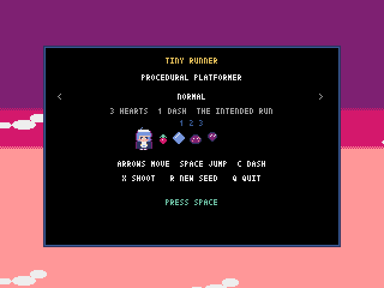
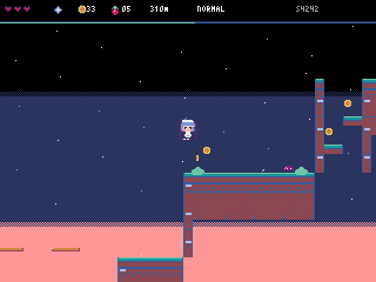
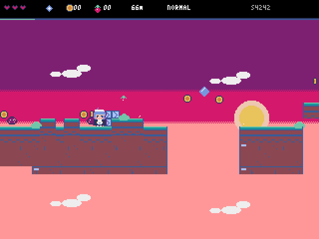
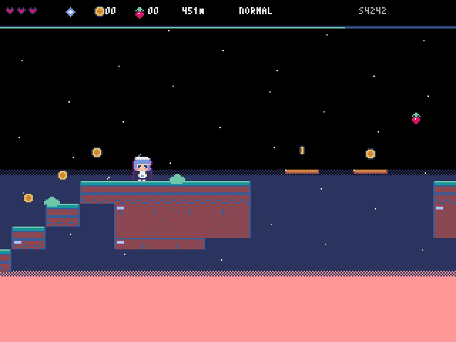

# TINY RUNNER

A **procedurally generated sky-castle platformer** written in [Pyxel](https://kitao.dev/pyxel/),
with a movement system borrowed from *Celeste*: **eight-way dash, mid-air dash crystals, and
optional strawberries**. The terrain is genuinely **three-dimensional** — wells, steep towers,
atriums and chasms — so a run climbs, drops, and climbs again, while the sky shifts from sunset
to starfield as you gain altitude. One file, zero external assets: all the art is ASCII drawn at
startup and baked into the image bank.



| | |
|---|---|
|  |  |
|  |  |

## Run it

```bash
python3 -m venv .venv
.venv/bin/pip install -r requirements.txt   # pyxel 2.9.9

.venv/bin/python tiny_runner.py                 # NORMAL
.venv/bin/python tiny_runner.py --easy          # 5 hearts / 2 air dashes
.venv/bin/python tiny_runner.py --hard          # denser hazards, faster crumble
.venv/bin/python tiny_runner.py --seed 1234
```

On macOS you can also **double-click `play.command`** — it finds `.venv` next to the script
(or falls back to a `.venv` in the current directory).

## Windows build

There is no checked-in binary. `.github/workflows/build.yml` builds a **single-file
`TinyRunner.exe`** on `windows-latest` and uploads it as a workflow artifact — grab it from the
Actions tab (or attach it to a release). Playwright/PyInstaller cannot cross-compile, which is
why the build runs on a Windows runner: pack to `.pyxapp` → wrap in a launcher → `pyinstaller
--onefile --windowed`. The workflow's last step **actually launches the exe and waits 10
seconds**, so a broken build fails instead of being uploaded.

The exe is **unsigned**, so Windows SmartScreen shows its blue "Windows protected your PC"
dialog on first run: *More info → Run anyway*. That is the default prompt for unknown
publishers, not an error.

## Controls

| Key | Action |
|---|---|
| ← → / A D | move |
| Space / Z / ↑ / W | jump (hold longer to jump further) |
| Space (in the air) | **double jump** |
| Space (against a wall) | **wall jump** — kicks you away; hold the direction to stick back and keep climbing |
| **C / J / SHIFT** | **dash** (eight directions; 1 per airtime, 2 on EASY; landing, dash crystals and springs refill it) |
| **X / K** | **shoot** (infinite ammo, 9-frame cooldown, 3 bullets max, 128 px range) |
| **← → or 1 2 3 on the title screen** | **change difficulty** |
| R | new seed, same difficulty |
| Q | quit |

Dash details:

- The dash follows the direction you hold (including ↑, which jumps first then dashes upward);
  with no direction held you dash the way you face.
- Press jump mid-dash for a **dash-jump**, keeping the horizontal speed (good for 2–3 extra tiles).
- A dash passes through one-way platforms and stops against solid walls — which turns it into a
  wall-jump opportunity.

## Three difficulties

Jumping, dashing and gravity are **identical** across difficulties, so muscle memory carries
over. What changes is forgiveness and hazard density.

| | EASY | NORMAL | HARD |
|---|---|---|---|
| Hearts | **5** | 3 | 3 |
| Air dashes | **2** | 1 | 1 |
| Hazard rate | 0.62× | 1.0× | 1.35× |
| Pit / chasm width cap | 3 tiles | 4 tiles | 5 tiles |
| Crumble timer | 52 frames | 36 frames | **28 frames** |
| Moving-platform speed | 0.75× | 1.0× | 1.28× |
| Dash-gap width | 8 tiles | 9 tiles | **10 tiles** |
| Wisp rate | 0.35× | 0.75× | 1.05× |

Switch at the title screen with ← → (or 1/2/3); `R` restarts with the same difficulty.

## How it plays

- You start on the castle foundation at row 66. The route is not a straight line: a run spans a
  **45–67 row** vertical drop, dives twice on purpose and climbs back; the flag sits between
  rows 9–30 (14 on average) at the top of a tower.
- 3 hearts (5 on EASY): stomp slimes, break grey brick, collect coins, reach the flag.
- Touching an enemy's side or the spikes costs 1 heart (**knockback, not teleport**); falling out
  of the map costs 1 heart and respawns you at the last safe ledge.
- Bullets kill slimes and wisps, and shatter the **grey cracked brick** in castle walls (one coin
  per brick).
- **Crumbling slabs**: 0.47–0.87 s after you step on one it breaks (faster on higher
  difficulties) — you have to cross in one go, and it grows back.
- **Moving platforms**: floating platforms shuttle back and forth and carry you along; the 8-tile
  chasm can only be crossed this way.
- **Dash gaps**: an 8–10 tile chasm with a **blue dash crystal** floating in the middle — jump,
  then dash across.
- **Springs**: launch you **8 tiles** up onto a one-way platform above, and refill your dash.
- **Strawberries**: 11–16 per run, always in risky spots. Optional; the results screen shows
  `BERRIES n/m`, and a full clear shows `ALL BERRIES!`.
- **Wisps**: drift near an anchor and only chase once you get close (0.28 px/frame — much slower
  than you). Shoot or stomp them; they usually guard a strawberry.
- The camera follows vertically; the higher you go, the further the night sky creeps down from
  the top of the screen, and the stars fade in.

## Vertical space

The altitude target for a run is not a straight line from 66 to 14 — it is a **slope plus two
sine waves** (±8 rows). Each piece computes `delta = current row - target row`: fall more than 4
rows behind and only climbing pieces are allowed; get more than 4 rows ahead and the generator
forces flat or descending pieces. That produces the climb → traverse/dive → climb rhythm.

Four vertical pieces were added for this (other pieces contribute height too):

| Piece | Shape | Net height |
|---|---|---|
| `steep` | climbs 3 rows per 3 tiles — you must use full jumps | **+12~18 rows** |
| `well` | a 13–17 row two-walled shaft with staggered platforms | **+13~17 rows** |
| `atrium` | two levels: spring up to the second; or walk to the end and wall-jump 7 tiles | **+7 rows** |
| `chasm` | a 10–14 row cliff face with staggered narrow ledges | **−10~−14 rows** |

Measured: a run averages **5.2** vertical pieces and a **53-row** (45–67) height span.
`--tour` renders all 26 piece types, framing vertical pieces at their midpoint so tower tops
are not cut off.

The sky follows altitude too: three-tone sunset plus a sun at the bottom, the night band creeping
down from the top as you climb (a continuous dark band with 4 px jitter on its edge), stars fading
in with height, and pure black plus a full starfield at the top. See `shots/sky_low.png`,
`shots/sky_mid.png`, `shots/sky_high.png`.

## The character

16×19 pixels — blue hair, a white frilled headband, a **navy dress** and a white apron with a
small blue whale on it. The hitbox is only 8×13: **drawing larger than the hitbox** is the
standard trick — it reads as a body without changing how it feels. To tweak the pixels, run
`tools/sprite_preview.py` to blow the whole sprite sheet up.

> Palette trap: the outline uses `PURPLE`, not the usual `NAVY`, because the dress itself is
> navy — use `NAVY` for both and the dress merges into its own outline; flip it (purple dress,
> navy outline) and the dress disappears against a purple sky.

## Abilities are measured, not guessed

`tools/calib.py` measures hold frames against jump distance (full-speed take-off, landing back at
the same height):

| Hold frames | 1 | 4 | 8 | 12 | 15 |
|---|---|---|---|---|---|
| Horizontal distance | 3.2 tiles | 4.5 | 5.6 | 6.5 | **7.0** |
| Apex | 7 px | 19 | 30 | 37 | 39 |

`tools/calib2.py` measures the advanced moves:

| Ability | Measured |
|---|---|
| Single jump apex | 4.2 tiles |
| **Double jump apex** | **6.9 tiles** |
| **Repeated wall jumps** | **20 tiles in 400 frames** (no cap — climb any wall) |

`tools/calib3.py` measures dash and spring (written when dashing was added):

| Move | Measured |
|---|---|
| Ground dash, 8 frames | 4.7 tiles |
| Full-speed jump | 7.9 tiles |
| **Jump + air dash** | **11.8 tiles** |
| Upward dash | 3.9 tiles |
| Spring | 7.8 tiles |

The critical detail: air jumps and dashes must require a **fresh press** (a rising edge).
Otherwise holding the button eats the double jump or the dash one frame after the first jump —
a bug that `tools/calib2.py` surfaced as "the double jump is exactly as high as a single jump".
The dash had the same trap.

## Terrain is built from 26 pieces

A run chains 34 pieces from row 66 up to the flag (rows 9–30) across a 45–67 row span.
`dash` and `spring` are **guaranteed at least once** (around pieces 12 and 22), so every run
teaches the new moves.

| Group | Pieces |
|---|---|
| Basic | `flat` · `pit` · `steps` · `spikes` |
| Aerial | `ledge` · `islands` · `bridge` · `spire` |
| Castle | `plaza` · `rampart` · `stair` · `shaft` · `drop` |
| Vertical | `chimney` · `canyon` · `tower` · `tunnel` · `gauntlet` |
| **Vertical (new)** | **`steep`** · **`well`** · **`atrium`** · **`chasm`** |
| Hazards | `crumble` · `mover` |
| New mechanics | **`dash`** (gap + crystal) · **`spring`** (spring ferry) |

Every piece guarantees solid ground at both ends (so pieces concatenate safely) and that each
hop is within the player's reach — asserted on the spot with `_hop()` / `_dash_hop()`, so a bad
piece makes `--sweep` throw instead of generating an unbeatable level.

> `rampart`'s crenellations are **decoration only** (`DECOR` tiles, no collision). They used to
> be 1-tile solid blocks, which raised both the landing and the take-off point by a tile — and
> turned HARD's 5-tile gaps into random accidents.

## Self-checks

```bash
.venv/bin/python tools/smoke_test.py                  # state machine + difficulties + dash/crystal/spring/strawberry + vertical space
.venv/bin/python tiny_runner.py --sweep 50            # geometric clear rate (NORMAL)
.venv/bin/python tiny_runner.py --sweep 50 --hard     # HARD
.venv/bin/python tiny_runner.py --sweep 50 --easy     # EASY
.venv/bin/python tiny_runner.py --sweep 20 --harsh    # with damage (the bot can die)
.venv/bin/python tiny_runner.py --demo --god --seed 4242 --out shots
.venv/bin/python tiny_runner.py --demo --god --seed 4242 --hard --out shots/hard
.venv/bin/python tiny_runner.py --tour --seed 4242 --out tour   # terrain catalogue
.venv/bin/python tools/calib.py && .venv/bin/python tools/calib2.py && .venv/bin/python tools/calib3.py
```

Measured here (Pyxel 2.9.9):

| Check | Result |
|---|---|
| Geometric clear rate (NORMAL) | **50/50** |
| Geometric clear rate (HARD) | **50/50** |
| Geometric clear rate (EASY) | **50/50** |
| Clear rate with damage (same bot, NORMAL) | 19/20 |
| Clear rate with damage (same bot, HARD) | 17/20 |
| World size | 84 rows tall (672 px), camera follows vertically |
| Height span per run | 45–67 rows (53 average) |
| Vertical pieces per run | 5.2 average (steep / well / atrium / chasm) |
| Run length | ~3100 frames ≈ 52 s |
| Strawberries per run | 11–16 (the bot picks up 8–9 on the way) |

`sweep` skips `draw`/`flip`, so 100 seeds finish in seconds (60 fps real time, ~300× fast-forward).

## Gotchas from building this (Pyxel 2.9.9)

1. **Notes only accept `c0`..`b4`** — writing `c5` raises `Invalid sound note '5'`.
2. **Probe one extra pixel below the feet** for ground checks, or the height oscillates between
   `y` and `y+0.34` and `on_ground` drops every other frame.
3. **Test the whole flagpole at the finish**, not just the flag — otherwise a player can jump over
   it and fly off the map.
4. **A checkpoint needs ground to its right**, or you die, respawn on the ledge edge, and die again
   in place.
5. **"Ground" cannot mean "the topmost solid tile"** — tunnel ceilings get grass painted on them.
6. **A platform above a spike strip must cover the whole strip.** Cover only the middle and you
   drop off the right end onto the last spike.
7. **`pyxel.dither` is a checkerboard, not alpha.** Over a full screen it becomes noise; only use
   it in narrow transition bands.
8. **Parallax phase must hang off world coordinates, not the screen loop index.** The cloud
   vertical phase was `(i*137 - oy) % P` with `i` as the screen column, so clouds changed identity
   as `ox` wrapped and jumped vertically.
9. **Put the camera in place at startup.** Interpolating from 0 sweeps through every sky band and
   star level in the first second.
10. **Small hazards read by colour and height, not shape** — the spikes only became visible as
    white triangles on a red base.
11. **Moving platforms are not tiles.** Collision has to be handled separately: the player must be
    carried by the platform, and the bot has to know to *wait* for it.
12. **Dash input must be a rising edge, and the landing refill must skip frames where you are
    dashing.** Otherwise holding dash burns the charge and refills it in one frame (infinite ground
    dashes), and after knockback it feels like the button stopped working.
13. **Do not clip dash speed back to run speed in one frame.** Keep a 10-frame momentum window
    (capping 2.6 → 1.8 gradually); otherwise the 11.8-tile jump-dash shrinks to 8 and feels like
    hitting a wall.
14. **No 1-tile obstacles at gap edges.** `rampart`'s solid crenellations turned 5-tile gaps into
    random accidents: the player *walks* off the crenellation, the grounded branch never runs, and
    by the time they land on the last flat tile they are already in the pit. Crenellations are
    `DECOR` now; collision belongs to the ground.
15. **The bot may `think()` once per frame.** The fast-forward demo called it once inside
    `update()` and again in the main loop, desynchronising its internal state so it got stuck on
    the same gap — pass the keys through a `holder` instead.
16. **Judge a dash gap by the gap itself, not by the span from the player's position.** Jump one
    tile early and the span lies; a 5-tile pit eats a dash, you overshoot and fall into the far
    side. Dashes are for covering distance, not for accelerating into a wall.
17. **Leave a landing budget on big drops.** `chasm`'s narrow ledges ran all the way to the cliff
    edge, so falling off the lowest ledge drifted 2–3 tiles and cleared the cliff bottom into the
    next gap (HARD seed 1043 fell 44 times). The bottom is 16–20 tiles wide now, and the last 6
    columns have no ledges.
18. **The altitude target cannot be a monotonic slope.** Allocating by "remaining height /
    remaining pieces" makes the generator jog upstairs and waste the vertical space; with sine
    waves plus a `delta` threshold, a run dives twice on purpose.
19. **The night sky cannot change colour all at once.** A 16-colour palette has no gradient, and
    a full-screen swap *snaps*; let the dark band press down continuously from the top, jitter only
    a 4 px edge, and fade the stars in with height.

## License

MIT — see [LICENSE](LICENSE).
